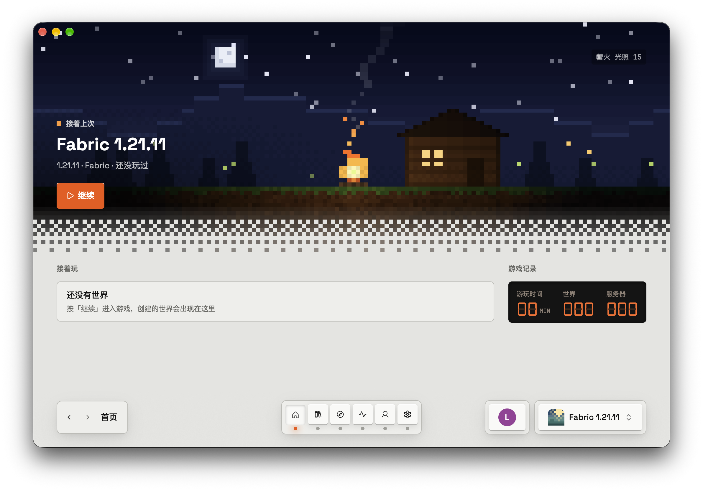

<div align="center">


# LumilioCL

原生、高性能、可扩展的 Minecraft 启动器，用 Rust + GPUI 写成，不依赖 Electron 或 WebView。

[](https://github.com/EdwinZhanCN/LumilioCL/releases/latest)
[](LICENSE)
[](https://github.com/EdwinZhanCN/LumilioCL/actions/workflows/ci.yml)

简体中文 · [English](README.en.md)



</div>

游戏库与整合包导入、Modrinth / CurseForge 内容、自动管理 Java、世界地图、崩溃诊断和插件，功能介绍见[官网](https://launcher.lumilio.org/docs/guide/)。

## 下载

支持 macOS（Apple 芯片）、Windows 10 / 11（x64）和 Linux（x64）。

- [官网下载](https://launcher.lumilio.org/)（国内直连）或 [GitHub Releases](https://github.com/EdwinZhanCN/LumilioCL/releases/latest)
- 安装和校验 SHA-256：[安装指南](https://launcher.lumilio.org/docs/install/)

## 第一次打开时系统弹出警告？

请先确认安装包来自本仓库的 [GitHub Releases](https://github.com/EdwinZhanCN/LumilioCL/releases/latest)。完整说明见[官网](https://launcher.lumilio.org/docs/install/#首次打开时的系统提示)。

- **macOS**：弹出「无法打开」时点**完成**，再到**系统设置 → 隐私与安全性**最下方点**仍要打开**。macOS 14 及更早：按住 Control 键点应用，选**打开**。
- **macOS 提示「已损坏」**：先重新下载并核对 SHA-256；确认来源可信后，才在终端运行：

  ```sh
  xattr -dr com.apple.quarantine /Applications/LumilioCL.app
  ```

- **Windows**：Edge 提示「不常下载」时点 **…** → **保留** → **仍然保留**；出现「Windows 已保护你的电脑」时点**更多信息** → **仍要运行**。

## 从源码构建

```sh
cargo run -p lumilio-app   # 运行
just check                 # 构建、测试、clippy、rustfmt，和 CI 一致
just package               # 为当前平台打包到 dist/
```

开发环境和贡献规范见[参与开发](https://launcher.lumilio.org/docs/contribute/)，开发约定见 [`AGENTS.md`](AGENTS.md)。

## 许可证与致谢

以 [AGPL-3.0-only](LICENSE) 发布。部分代码改编自 [Modrinth App](https://github.com/modrinth/code)（GPL-3.0-only）和 [HMCL](https://github.com/HMCL-dev/HMCL)（GPL-3.0-or-later），投影渲染基于 [Nucleation](https://github.com/Schem-at/Nucleation)（MIT）和 [Schematic-Mesher](https://github.com/Schem-at/Schematic-Mesher)（AGPL-3.0-only），来源记在对应文件的注释里。字体、图标和渲染依赖的许可证见 [`ATTRIBUTIONS.md`](ATTRIBUTIONS.md) 与 [`crates/lumilio-ui/assets/ATTRIBUTIONS.md`](crates/lumilio-ui/assets/ATTRIBUTIONS.md)。LumilioCL 没有使用 Modrinth 的品牌。

## 免责声明

1. **非官方产品声明**：**LumilioCL** 是一个独立的第三方开源项目，**并非** Minecraft 官方产品，未获 Mojang Studios、Microsoft 或网易（NetEase）的批准、授权或与其存在任何关联。
2. **零托管与纯工具属性**：本项目仅作为本地客户端辅助工具（用于管理本地文件、配置 JVM 参数及引导启动）。LumilioCL **不存储、不托管、也不直接分发**任何 Minecraft 游戏本体文件、官方资源或受版权保护的商业资产。所有游戏核心文件均由用户在本地通过客户端直接从 Mojang 官方接口或用户自行选择的第三方公开镜像源获取。
3. **正版验证与合规使用**：请支持正版游戏。使用本启动器下载或运行游戏需拥有合法的 Minecraft 正版账号，并严格遵守 [Minecraft 最终用户许可协议 (EULA)](https://www.minecraft.net/eula)。开发者不对任何绕过正版验证、修改游戏文件或违反官方条款的行为负责。
4. **第三方资源与服务免责**：本软件可能支持调用第三方 API 或镜像服务（如 BMCLAPI、CurseForge、Modrinth 等）。这些服务及其提供的内容（包括但不限于 Mod、整合包、材质包、光影）均由各自独立平台及原作者所有并承担责任。LumilioCL 不对第三方服务的可用性、安全性或内容的合法性作任何担保。
5. **无担保声明**：本软件按“原样”（"AS IS"）提供，不附带任何明示或暗示的担保。在任何情况下，项目贡献者均不对因使用或无法使用本软件而导致的任何数据丢失、账号异常或直接/间接损失承担责任。
